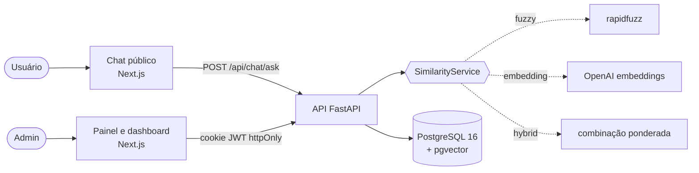

# Chatbot de FAQ com Dashboard Analítico

Chatbot que responde perguntas frequentes encontrando, na base de conhecimento, a pergunta cadastrada mais parecida com o que o usuário escreveu. Tem painel administrativo para manter a base e dashboard com métricas de uso.

[](https://github.com/renato-saldanha/faq-chatbot/actions/workflows/ci.yml)


### [▶ Abrir a demo](https://faq-chatbot-psi.vercel.app)

Não precisa de cadastro. Experimente perguntar "Como recupero minha senha?" ou "Vocês aceitam boleto?". Para ver o painel, clique em **Painel interno**: no modo demonstração o e-mail e o código de acesso já vêm preenchidos. Os dados da demo são fictícios.

---

## Sobre o projeto

Equipes de atendimento passam boa parte do dia respondendo as mesmas perguntas. Este projeto automatiza essa parte. O usuário pergunta com as próprias palavras, o sistema acha a pergunta cadastrada mais próxima e devolve a resposta. Toda interação fica registrada, com ou sem resposta, e o dashboard mostra o que as pessoas mais perguntam, o que ficou sem resposta e como o volume evolui. É com essa informação que a equipe decide o que acrescentar à base.

O ponto central foi a busca por similaridade. Implementei três abordagens (léxica, semântica e híbrida), medi as três contra um gabarito de perguntas e escolhi a vencedora pelos números. O resultado está em [Decisão técnica: qual algoritmo de similaridade](#decisão-técnica-qual-algoritmo-de-similaridade).

## Funcionalidades

**Chat público**
- Entende paráfrases e erros de digitação, não só a pergunta escrita igual à cadastrada
- Quando não encontra correspondência, responde com uma mensagem padrão e registra a pergunta para análise
- Limite de 10 perguntas por minuto por IP

**Painel administrativo** (login sem senha, por código enviado ao e-mail)
- Cadastro, edição, exclusão e ativação/desativação de perguntas, organizadas por categoria. As mudanças valem no chat na hora, sem reiniciar nada.
- Dashboard com total de consultas, perguntas mais frequentes, perguntas sem resposta, distribuição por categoria e evolução diária, tudo filtrável por período
- Tema claro e escuro

## Destaques técnicos

- **Três algoritmos de similaridade, escolhidos por medição.** No gabarito de 21 casos, embeddings da OpenAI acertaram 100%, contra 76% da busca léxica e 81% da híbrida. O algoritmo ativo é escolhido por variável de ambiente.
- **Degradação controlada.** Se a API da OpenAI falhar (timeout, cota, chave inválida), o chat passa a usar a busca léxica e registra um aviso no log, em vez de devolver erro 500.
- **Arquitetura em camadas com injeção de dependência.** `api → services → repositories → models`, e nenhuma camada pula a de baixo. Os services são testados com fakes, sem precisar de um Postgres rodando.
- **Login sem senha e com proteção contra força bruta.** Código OTP de 6 dígitos e sessão em JWT num cookie `httpOnly` / `secure` / `samesite=strict`. Há limites separados para pedir código (3 a cada 15 min) e para tentar validá-lo (5 a cada 15 min).
- **Demo serverless sem estado.** Na Vercel não há memória compartilhada entre invocações nem servidor de e-mail. No modo demonstração, o código OTP é derivado por HMAC-SHA256 do segredo, do e-mail e de uma janela de 5 minutos, então qualquer instância valida um código gerado por outra.
- **Testes em três níveis.** 96 testes no backend (pytest), 38 no frontend (Vitest + Testing Library) e 9 E2E (Playwright) rodando contra a stack Docker real. Lint e checagem de tipos com ruff, mypy, ESLint e `tsc`. Tudo roda no GitHub Actions a cada push.

## Stack

| Camada | Tecnologias |
|---|---|
| Backend | Python 3.11, FastAPI, SQLAlchemy 2.0 assíncrono (asyncpg), Alembic, Pydantic v2, slowapi |
| Similaridade | rapidfuzz, OpenAI `text-embedding-3-small`, pgvector |
| Banco | PostgreSQL 16 com a extensão pgvector |
| Frontend | Next.js 16 (App Router), React 19, TypeScript, TanStack Query, Zustand, Recharts, Zod |
| Testes | pytest, Vitest, Testing Library, Playwright |
| Infra | Docker Compose, GitHub Actions, Vercel e Neon |

## Arquitetura



O backend tem dois fluxos bem separados. O chat é público. Todo o resto exige sessão de admin.

```
Chat (público)
  POST /api/chat/ask                    rate limit de 10/min por IP
    → ChatService.ask()
      → SimilarityService.find_best_match()   fuzzy | embedding | hybrid
        → FaqRepository                       Postgres / distância de cosseno no pgvector
      → InteracaoRepository.create()          registra a interação, com ou sem resposta
    ← resposta + score, ou sem_resposta: true abaixo do limiar

Admin (sessão obrigatória)
  POST /api/auth/otp/request → código por e-mail
  POST /api/auth/otp/verify  → cookie httpOnly com JWT (HS256)
  /api/faq/* e /api/metrics/*
    → require_admin_session valida o JWT antes de qualquer outra coisa
      → FaqRepository (CRUD) | repositórios de métricas (dashboard)
```

Padrões usados:

- **Strategy:** `SimilarityService` é uma interface com três implementações (`Fuzzy`, `Embedding`, `Hybrid`). O `ChatService` depende só da interface, o que permitiu acrescentar os algoritmos semânticos sem mexer no chat nem nas métricas.
- **Decorator:** `FallbackSimilarityService` envolve os backends que dependem da OpenAI e cai para o fuzzy em caso de falha.
- **Repository:** toda query SQLAlchemy fica nos repositórios. Services nunca montam `select(...)`.
- **DTOs imutáveis:** `@dataclass(frozen=True)` entre as camadas internas. O Pydantic fica restrito à validação de entrada e saída HTTP.
- **Frontend:** um único cliente HTTP (`src/lib/api.ts`), componentes de domínio apresentacionais, tipos TypeScript espelhando os schemas do backend e design tokens em variáveis CSS.

As convenções completas estão em [docs/ARQUITETURA.md](docs/ARQUITETURA.md).

## Decisão técnica: qual algoritmo de similaridade

Buscar a "pergunta mais parecida" pode ser feito de várias formas, cada uma com seu custo. Implementei as três abaixo e comparei todas no mesmo gabarito ([scripts/similarity_eval_dataset.json](backend/scripts/similarity_eval_dataset.json)), com 21 casos: 10 fáceis, 5 paráfrases, 5 com erro de digitação e 1 sem resposta de propósito.

| Algoritmo | Acurácia | Paráfrases | Latência média |
|---|---|---|---|
| `fuzzy`, léxico (rapidfuzz) | 76,2% (16/21) | 0% (0/5) | ~7 ms |
| **`embedding`, semântico (OpenAI)** | **100% (21/21)** | **100% (5/5)** | ~330 ms |
| `hybrid`, 0,6 · embedding + 0,4 · léxico | 81,0% (17/21) | 20% (1/5) | ~380 ms |

**O vencedor foi `embedding`.** A busca léxica não acerta paráfrases, porque compara letras e não significado. A híbrida ficou *abaixo* do embedding puro: em perguntas curtas de um domínio fechado, o termo léxico derruba o score justamente quando o sentido bate e as palavras divergem.

A primeira rodada do embedding deu 90,5%. Em vez de mexer em parâmetro às cegas, analisei cada falha:

- *"Esqueci minha senha, e agora?"* caía num item vizinho da base ("Esqueci meu login"), porque os dois textos eram quase idênticos em significado. A correção foi na base, não no algoritmo: reescrevi o item concorrente para um cenário realmente distinto.
- *"Quero falar com uma pessoa de verdade, não um robô"* teve score 0,59, um centésimo abaixo do limiar de 0,60. Baixei o limiar para 0,55 só depois de confirmar no gabarito que nenhum caso sem resposta chega perto desse valor (o teto observado foi ~0,30).

Para rodar a avaliação contra o algoritmo ativo:

```bash
docker compose exec backend python -m scripts.eval_similarity
```

A saída bruta de cada rodada está em [docs/similarity_eval_output.txt](docs/similarity_eval_output.txt).

> A demo pública usa `fuzzy`, para não depender de chave de API nem gerar custo. Paráfrases funcionam melhor rodando localmente com `SIMILARITY_BACKEND=embedding`.

## Como rodar localmente

Pré-requisito: Docker.

```bash
cp .env.example .env
docker compose up --build
```

- Frontend: http://localhost:3000
- API: http://localhost:8000 (documentação interativa em `/docs`)

No primeiro boot, o backend aplica as migrations e popula a base com 50 perguntas fictícias em 6 categorias. Não há nenhum passo manual de banco.

**Login no painel:** sem `SMTP_HOST` configurado, o código OTP não é enviado por e-mail. Ele aparece no log do backend:

```bash
docker compose logs -f backend
# procure por: SMTP não configurado — OTP para <email>: <código>
```

Para usar o algoritmo semântico, preencha `OPENAI_API_KEY` e defina `SIMILARITY_BACKEND=embedding` no `.env`.

Para voltar o banco ao estado inicial: `docker compose down -v && docker compose up --build`.

<details>
<summary><strong>Variáveis de ambiente</strong></summary>

Todas estão em [.env.example](.env.example).

| Variável | Descrição |
|---|---|
| `DATABASE_URL` | Conexão assíncrona com o Postgres (já aponta para o serviço do Compose) |
| `SIMILARITY_BACKEND` | `fuzzy`, `embedding` ou `hybrid` |
| `SIMILARITY_THRESHOLD` | Score mínimo (0 a 1) para aceitar uma correspondência. Padrão `0.55`, calibrado no gabarito |
| `OPENAI_API_KEY` / `OPENAI_MODEL` | Necessárias para `embedding` e `hybrid`. Modelo: `text-embedding-3-small` |
| `ADMIN_EMAIL` | Único e-mail autorizado a entrar no painel |
| `SMTP_HOST` / `SMTP_PORT` / `SMTP_USER` / `SMTP_PASSWORD` | Envio do código OTP. Vazio, o código vai para o log |
| `JWT_SECRET_KEY` | Segredo de assinatura da sessão. Troque em produção |
| `DEMO_MODE` | `1` liga o modo demonstração (OTP derivado por HMAC e devolvido na resposta) |
| `COOKIE_SECURE` | `true` por padrão. Use `false` só em HTTP local fora de localhost |
| `CORS_ORIGINS` | Origens permitidas, separadas por vírgula. Padrão `http://localhost:3000` |

</details>

<details>
<summary><strong>Deploy na Vercel</strong></summary>

A demo roda no plano gratuito, com dois projetos na Vercel e o Neon como banco (Postgres + pgvector):

- **Backend** (`backend/`): FastAPI como função Python. O `.vercelignore` exclui o `pyproject.toml` para a Vercel instalar a partir do `requirements.txt`.
- **Frontend** (`frontend/`): Next.js com `rewrites` de `/api/*` para o backend. Navegador e API ficam na mesma origem, então o cookie `httpOnly` funciona sem CORS.
- **Banco:** integração Neon no projeto do backend. Migrations e seed rodam da máquina local contra o Neon (`alembic upgrade head` e `python -m scripts.seed_faq`). A URL no formato do Neon (`postgres://...?sslmode=require`) é adaptada automaticamente para o asyncpg.

| Projeto | Variável | Valor |
|---|---|---|
| backend | `DEMO_MODE` | `1` |
| backend | `ADMIN_EMAIL` | e-mail fictício, ex.: `admin@demo.test` |
| backend | `JWT_SECRET_KEY` | segredo aleatório (`openssl rand -hex 32`) |
| backend | `SIMILARITY_BACKEND` | `fuzzy` |
| backend | `DATABASE_URL` | injetada pela integração Neon |
| frontend | `BACKEND_URL` | URL do backend, usada nos `rewrites` |
| frontend | `NEXT_PUBLIC_DEMO` | `1` exibe a faixa "Modo demonstração: dados fictícios" |

</details>

## Testes

```bash
# Backend
cd backend
pytest tests/ -v            # 96 testes
ruff check . && mypy app/

# Frontend
cd frontend
npm run test                # 38 testes
npm run lint && npx tsc --noEmit

# E2E (precisa da stack de pé: docker compose up --build)
cd frontend
npx playwright test         # 9 testes
```

Os testes E2E cobrem os fluxos críticos e os casos de erro: pergunta com e sem resposta, estouro do rate limit, bloqueio do painel sem login, código inválido, login completo, CRUD refletindo no chat, carregamento das métricas e logout. A autenticação acontece uma única vez e a sessão é reaproveitada pelos outros specs, para não esbarrar no limite de pedidos de código.

O CI ([.github/workflows/ci.yml](.github/workflows/ci.yml)) roda três jobs: backend, frontend (incluindo o build do Next.js) e E2E com o `docker compose` real.

## Estrutura do projeto

```
backend/
├── app/
│   ├── api/            # Rotas: chat (público), faq e metrics (admin), auth
│   ├── services/       # ChatService, SimilarityService (Strategy), AuthService
│   ├── repositories/   # Única camada que acessa o banco
│   ├── models/         # Categoria, FaqItem, Interacao (SQLAlchemy)
│   └── auth/           # OTP e JWT
├── alembic/            # Migrations (pgvector + schema)
├── scripts/            # Seed da base e avaliação de similaridade
└── tests/

frontend/
├── src/app/
│   ├── (chat)/         # Chat público
│   ├── (auth)/login/   # Login por OTP
│   └── (dashboard)/    # faq/ e metricas/, protegidos pelo guard de sessão
├── src/components/     # Componentes de domínio e de UI
├── src/lib/api.ts      # Cliente HTTP único
└── e2e/                # Playwright

docs/                   # PRD, arquitetura, plano de implementação, saídas da avaliação
docker-compose.yml      # Postgres (pgvector) + backend + frontend
```

## Limitações conhecidas e próximos passos

- **Um único admin**, definido por variável de ambiente, sem tabela de usuários nem perfis.
- **O rate limit fica em memória**, por instância. Funciona num container único, mas na Vercel cada instância conta separadamente. O próximo passo seria um store compartilhado, como Redis.
- **No modo demonstração**, o código OTP não é de uso único e não há limite de tentativas. É um trade-off consciente: o código já é exibido na tela, e o objetivo ali é deixar qualquer pessoa entrar.
- **Faltam cabeçalhos de segurança** como CSP e HSTS.
- **Ideia para evoluir:** agrupar as perguntas sem resposta por tema, para indicar quais assuntos estão faltando na base. A tabela de interações já tem uma coluna de embedding (pgvector) reservada para isso.

## Documentação

- [docs/PRD.md](docs/PRD.md): requisitos e escopo
- [docs/ARQUITETURA.md](docs/ARQUITETURA.md): camadas, padrões e convenções de código
- [docs/PLANO_IMPLEMENTACAO.md](docs/PLANO_IMPLEMENTACAO.md): plano de implementação por etapas

## Autor

**Renato Saldanha** · [GitHub](https://github.com/renato-saldanha) · [renatosaldanha.com.br](https://www.renatosaldanha.com.br)
